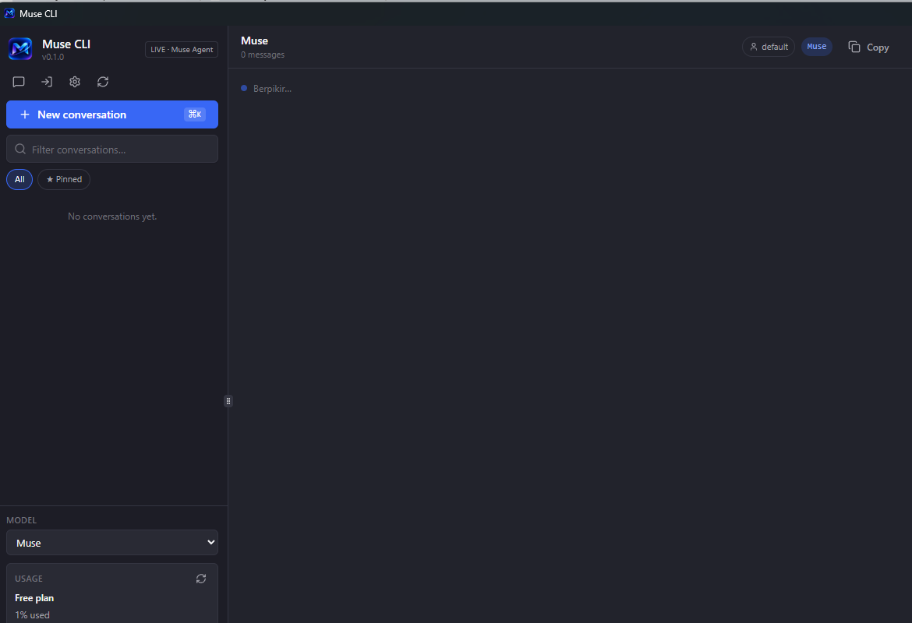
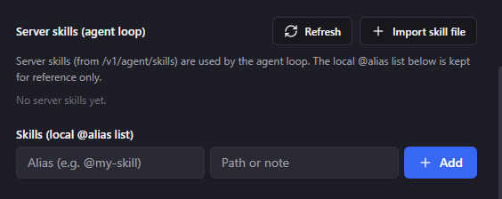

# Muse CLI

A desktop client for **Muse**, built from scratch with [Tauri](https://tauri.app/) + Rust.

Chat with Muse from a native Windows app: multiple Muse accounts, automatic quota fallback across your accounts, `@alias` skills, a Screen preview, a built-in terminal, and a live usage widget — with the UI in English or Bahasa Indonesia.

> **Not official.** Muse CLI is a third-party app. It is not affiliated with, endorsed by, or connected to Muse. See [Disclaimer](#disclaimer).

📖 **Bahasa Indonesia:** [README_ID.md](README_ID.md)

## Screenshots

Main window (dark theme, usage widget in the sidebar):



Skills settings — add a local `@alias` skill:



## Features

- **Multi-account** — sign in with several Muse accounts; they can work side by side. Add, disable, renew, or delete accounts from Settings.
- **3-phase quota waterfall** — when one account runs out, the app automatically falls through to the next:
  1. Weekly quota, across accounts in order (an exhausted account stays locked until its reset date).
  2. Extra quota, across accounts in order.
  3. Out of credit — a clear error when weekly + extra quota are exhausted on every account.
- **Skills (`@alias`)** — define local skills as `.md` files and call them by alias (for example `@my-skill`) right from the chat box. Server skills can be imported from a skill file.
- **Screen** — preview windows from the Screen tab while you work.
- **Terminal** — a built-in terminal tab (PowerShell).
- **Usage widget** — the sidebar shows your plan, weekly quota used (%), reset date, and extra tokens left. Refreshes on open or with the Refresh button.
- **English / Indonesian UI** — switch the interface language; Muse replies follow the language of your message.
- **In-app sign-in** — log in to Muse in a window inside the app (WebView2); your session is saved automatically.
- **Auto-start backend** — the Rust gateway backend starts with the app; no manual steps.

## Requirements

- Windows 10 or 11
- Internet connection
- Your own Muse account (free accounts work)

## Installation

1. Go to the [Releases page](https://github.com/anggaset1705/muse-cli/releases) and download the latest installer (**MSI** or **NSIS setup**).
2. Run the installer and follow the setup.
3. Open **Muse CLI**.
4. Sign in with your own Muse account in the window inside the app.
5. Start chatting.

No account or setup is needed from us — you log in with your own Muse account, inside the app.

## Build from source

Prerequisites:

- [Node.js](https://nodejs.org/) (LTS)
- Rust (stable toolchain — install via [rustup](https://rustup.rs/))
- Tauri CLI
- Tauri's Windows prerequisites: WebView2 (preinstalled on most Windows 10/11 systems) and the C++ build tools

```bash
git clone https://github.com/anggaset1705/muse-cli.git
cd muse-cli/muse-tauri

# 1. Install the frontend dependencies.
npm install

# 2. Build the Rust gateway (sidecar) and place it next to the app.
#    The gateway source lives in muse-gateway/ next to muse-tauri/.
npm run build:gateway

# 3. Build the Tauri app. The installer bundles the gateway sidecar,
#    so installing it is enough — no separate backend setup.
npm run tauri build
```

The installer is produced under `muse-tauri/src-tauri/target/release/bundle/`.

Repository layout:

```
muse-cli/
├── muse-tauri/     # Tauri desktop app (frontend + Rust side)
└── muse-gateway/   # Rust backend workspace (gateway)
```

## Usage

- **Sign in** — on first launch, the "Connect your Muse account" dialog appears. Click **Sign in inside the app**, sign in on the Muse page, and the account is saved automatically.
- **Add another account** — Settings → **Add account** (or **Other account** in the connect dialog), then sign in with the second Muse account.
- **Chat** — pick a project/workspace, type your message, and press Enter. Replies follow the language you wrote in.
- **Skills** — Settings → **Skills (local @alias list)**: enter an alias (for example `@my-skill`) and a path or note, click **Add**, then type `@my-skill` in the chat box. Use **Import skill file** to add a server skill.
- **Screen / Terminal** — use the **Screen** tab to preview windows and the **Terminal** tab for a terminal, both in the right-hand workspace panel.
- **Check your quota** — the **Usage** box under MODEL in the sidebar shows the plan, weekly quota used, reset date, and extra tokens left. Click the refresh icon to update it.

### How the quota waterfall works

1. **Phase 1 — weekly quota:** requests use the weekly quota of your accounts, in order. An account whose weekly quota is exhausted is skipped until its reset date.
2. **Phase 2 — extra quota:** if every account's weekly quota is exhausted, requests fall through to extra quota, again across accounts in order.
3. **Phase 3 — out of credit:** if weekly + extra quota are exhausted on all accounts, you get a clear "out of credit" error instead of a silent failure.

One honest limit: inside a single account, Muse itself decides whether a request consumes weekly or extra tokens — the app can only route requests between accounts, not control that split.

## FAQ

**Is this the official Muse app?**
No. Muse CLI is an independent, third-party desktop client built from scratch. It is not made by, affiliated with, or endorsed by Muse.

**Do I need my own Muse account?**
Yes. You sign in with your own Muse account (a free account works). The app does not provide an account.

**Where does my data go?**
The app runs locally on your machine. Your accounts and sessions are stored locally, and the app talks to Muse using your own signed-in account. There is no separate server run by this project that receives your data.

**Does it work offline?**
No — it needs an internet connection to reach Muse.

**Which platforms are supported?**
Windows 10/11 (see [Installation](#installation)). macOS and Linux builds are not provided.

## Contributing

Contributions are welcome — see [CONTRIBUTING.md](CONTRIBUTING.md).

## Disclaimer

Muse CLI is a third-party application, not affiliated with or endorsed by Muse. It uses browser automation and multi-account sign-in, which may carry a risk under Muse's Terms of Service (including account restrictions). Use it at your own risk.

## License

MIT — Copyright (c) 2026 anggaset1705. See [LICENSE](LICENSE).
