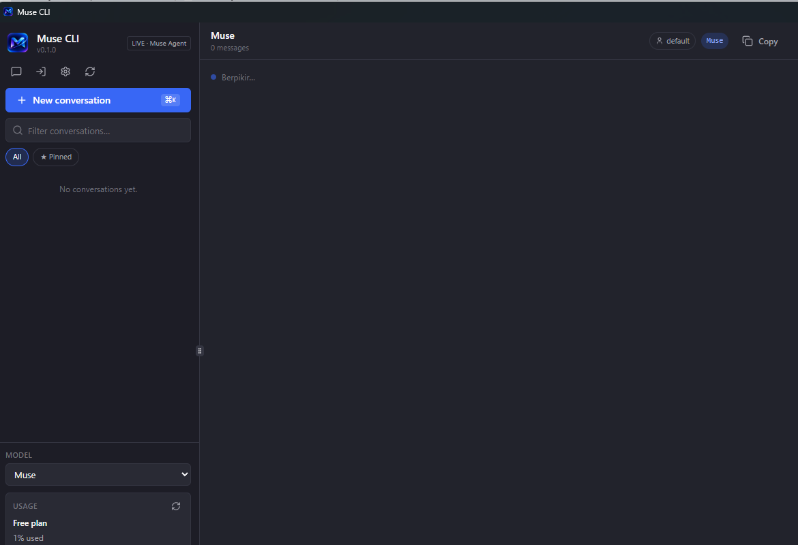
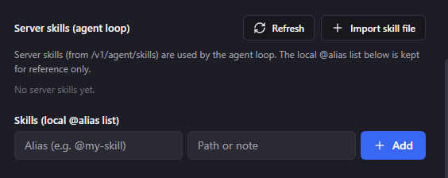

# Muse CLI

Aplikasi desktop untuk **Muse**, dibangun dari nol dengan [Tauri](https://tauri.app/) + Rust.

Ngobrol dengan Muse dari aplikasi Windows: banyak akun Muse sekaligus, kuota otomatis pindah ke akun berikutnya kalau satu akun habis, skill `@alias`, pratinjau Screen, terminal bawaan, dan widget usage yang nunjukin sisa kuota — tampilannya bisa Bahasa Inggris atau Bahasa Indonesia.

> **Bukan aplikasi resmi.** Muse CLI itu aplikasi pihak ketiga. Tidak dibuat oleh, tidak terafiliasi, dan tidak didukung oleh Muse. Lihat [Disclaimer](#disclaimer).

📖 **English:** [README.md](README.md)

## Screenshot

Jendela utama (tema gelap, widget usage di sidebar):



Pengaturan skill — nambah skill `@alias` lokal:



## Fitur

- **Multi-akun** — login dengan beberapa akun Muse sekaligus; semuanya bisa jalan bareng. Akun bisa ditambah, dimatikan, diperbarui, atau dihapus dari Settings.
- **Waterfall kuota 3 fase** — kalau satu akun habis kuotanya, aplikasi otomatis pindah ke akun berikutnya:
  1. Kuota mingguan, antar akun secara berurutan (akun yang kuota mingguannya habis dilewati dulu sampai tanggal resetnya).
  2. Kuota ekstra, antar akun secara berurutan.
  3. Kehabisan kuota — muncul pesan error yang jelas kalau kuota mingguan + ekstra di semua akun sudah habis.
- **Skill (`@alias`)** — bikin skill lokal dari file `.md` terus panggil pakai alias (misalnya `@my-skill`) langsung dari kotak chat. Skill server bisa ditambah lewat Import skill file.
- **Screen** — lihat pratinjau jendela dari tab Screen sambil kerja.
- **Terminal** — ada terminal bawaan (PowerShell) di tab Terminal.
- **Widget usage** — sidebar nunjukin paket, kuota mingguan terpakai (%), tanggal reset, dan sisa token ekstra. Diperbarui waktu dibuka atau lewat tombol Refresh.
- **UI Inggris / Indonesia** — bahasa tampilan bisa diganti; balasan Muse ngikutin bahasa pesanmu.
- **Login di dalam aplikasi** — login Muse lewat jendela di dalam aplikasi (WebView2); sesinya tersimpan otomatis.
- **Backend jalan otomatis** — backend gateway (Rust) ikut nyala waktu aplikasi dibuka; nggak ada langkah manual.

## Syarat

- Windows 10 atau 11
- Koneksi internet
- Akun Muse sendiri (akun gratis bisa)

## Cara install

1. Buka [halaman Releases](https://github.com/anggaset1705/muse-cli/releases) lalu download installer terbaru (**MSI** atau **NSIS setup**).
2. Jalankan installernya, ikuti langkah-langkahnya.
3. Buka **Muse CLI**.
4. Login pakai akun Muse sendiri di jendela yang muncul di dalam aplikasi.
5. Langsung chat.

Nggak perlu daftar apa-apa ke kami — kamu login pakai akun Muse kamu sendiri, di dalam aplikasi.

## Build dari source

Yang perlu disiapkan:

- [Node.js](https://nodejs.org/) (LTS)
- Rust (toolchain stable — install lewat [rustup](https://rustup.rs/))
- Tauri CLI
- Prasyarat Tauri buat Windows: WebView2 (biasanya sudah ada di Windows 10/11) dan C++ build tools

```bash
git clone https://github.com/anggaset1705/muse-cli.git
cd muse-cli/muse-tauri

# 1. Install dependensi frontend.
npm install

# 2. Build gateway Rust (sidecar) dan letakkan di samping aplikasi.
#    Source gateway ada di muse-gateway/, di samping muse-tauri/.
npm run build:gateway

# 3. Build aplikasi Tauri. Installer sudah membundel gateway,
#    jadi install saja sudah cukup — tidak perlu setup backend terpisah.
npm run tauri build
```

Installer hasil build ada di `muse-tauri/src-tauri/target/release/bundle/`.

Isi repo:

```
muse-cli/
├── muse-tauri/     # Aplikasi desktop Tauri (frontend + sisi Rust)
└── muse-gateway/   # Workspace backend Rust (gateway)
```

## Cara pakai

- **Login** — waktu pertama dibuka, muncul dialog "Connect your Muse account". Klik **Sign in inside the app**, login di halaman Muse, akun langsung tersimpan otomatis.
- **Tambah akun lain** — Settings → **Add account** (atau **Other account** di dialog connect), lalu login dengan akun Muse kedua.
- **Chat** — pilih project/workspace, ketik pesan, tekan Enter. Balasan Muse ngikutin bahasa yang kamu pakai.
- **Skill** — Settings → **Skills (local @alias list)**: isi alias (misalnya `@my-skill`) dan path atau catatan, klik **Add**, lalu ketik `@my-skill` di kotak chat. Buat nambah skill server, pakai **Import skill file**.
- **Screen / Terminal** — pakai tab **Screen** buat pratinjau jendela dan tab **Terminal** buat terminal, dua-duanya di panel workspace sebelah kanan.
- **Cek kuota** — kotak **Usage** di bawah MODEL di sidebar nunjukin paket, kuota mingguan terpakai, tanggal reset, dan sisa token ekstra. Klik ikon refresh buat memperbarui.

### Cara kerja waterfall kuota

1. **Fase 1 — kuota mingguan:** request pakai kuota mingguan akun-akunmu, berurutan. Akun yang kuota mingguannya habis dilewati sampai tanggal resetnya.
2. **Fase 2 — kuota ekstra:** kalau kuota mingguan semua akun habis, request pindah ke kuota ekstra, berurutan juga antar akun.
3. **Fase 3 — kehabisan kuota:** kalau kuota mingguan + ekstra di semua akun habis, muncul pesan error "out of credit" yang jelas, bukan gagal diam-diam.

Satu batasan yang jujur: di dalam satu akun, Muse sendiri yang nentuin request itu makan kuota mingguan atau kuota ekstra — aplikasi cuma bisa ngatur request pindah antar akun, bukan ngatur pembagian itu.

## FAQ

**Ini aplikasi resmi Muse?**
Bukan. Muse CLI itu aplikasi desktop pihak ketiga yang dibangun dari nol. Bukan buatan Muse, bukan juga didukung oleh Muse.

**Butuh akun Muse sendiri?**
Iya. Kamu login pakai akun Muse kamu sendiri (akun gratis bisa). Aplikasi ini tidak menyediakan akun.

**Data saya dikirim ke mana?**
Aplikasi jalan lokal di komputermu. Akun dan sesimu tersimpan lokal, dan aplikasi ngobrol ke Muse pakai akunmu sendiri yang sudah login. Tidak ada server lain yang dijalankan proyek ini yang menerima datamu.

**Bisa dipakai offline?**
Nggak bisa — butuh internet buat terhubung ke Muse.

**Platform apa saja yang didukung?**
Windows 10/11 (lihat [Cara install](#cara-install)). Build macOS dan Linux tidak disediakan.

## Berkontribusi

Kontribusi dipersilakan — lihat [CONTRIBUTING.md](CONTRIBUTING.md).

## Disclaimer

Muse CLI adalah aplikasi pihak ketiga, tidak terafiliasi atau didukung oleh Muse. Aplikasi ini memakai browser automation dan login multi-akun, yang bisa berisiko menurut Ketentuan Layanan Muse (termasuk pembatasan akun). Pakai dengan risiko sendiri.

## Lisensi

MIT — Copyright (c) 2026 anggaset1705. Lihat [LICENSE](LICENSE).
